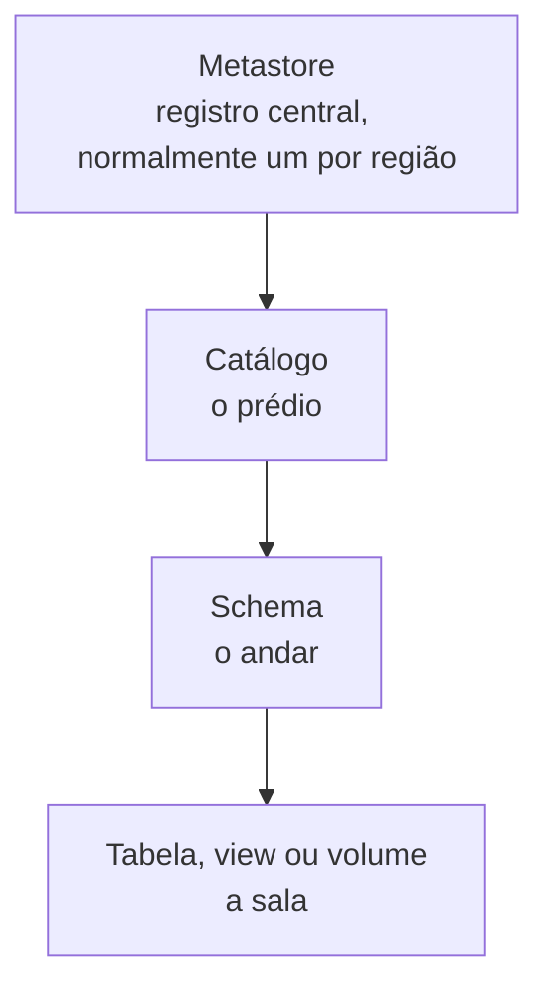
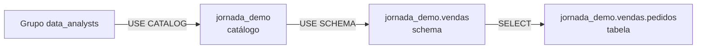
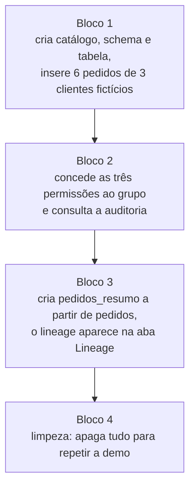

# Unity Catalog do zero

Materiais do vídeo **"Unity Catalog do zero"**, do canal **Jornada de Dados**, apresentado por Jennifer Maia.

O vídeo explica o Unity Catalog para quem está começando: a hierarquia **catálogo → schema → tabela**, como as permissões descem em cascata, por que `USE CATALOG` e `USE SCHEMA` são necessários e como o lineage aparece sozinho. Termina com uma demonstração prática no Databricks.

## Conteúdo

| Arquivo | O que é |
|---|---|
| [`slides_unity_catalog.html`](slides_unity_catalog.html) | Os 10 slides da apresentação. Um arquivo HTML sem dependências: basta abrir no navegador. |
| [`demo_unity_catalog.sql`](demo_unity_catalog.sql) | O script da demonstração, em 4 blocos. Executado no editor SQL do Databricks. |

## Pré-requisitos

- Um workspace Databricks com **Unity Catalog** ativo.
- Permissão para criar catálogos no metastore (`CREATE CATALOG`).
- Acesso ao grupo `data_analysts`, ou um grupo de teste no lugar dele (veja [Problemas comuns](#problemas-comuns)).
- Permissão para ler `system.access.audit`, usada na consulta de auditoria do bloco 2.

## Conceitos em 1 minuto

O Unity Catalog organiza os dados em três níveis, dentro de um **metastore** (o registro central, normalmente um por região):

Um caminho completo tem três partes separadas por ponto: `catalogo.schema.tabela`. No script, o caminho é `jornada_demo.vendas.pedidos`.

As permissões **herdam de cima para baixo**. Mas para chegar a uma tabela, o usuário precisa de três chaves:

Sem `USE CATALOG` e `USE SCHEMA`, o `SELECT` sozinho não funciona.

## Como usar

### 1. Slides

Abra `slides_unity_catalog.html` no navegador. Não precisa instalar nada, mas o arquivo carrega fontes do Google Fonts, então é preciso de internet. Para apresentar, use tela cheia (F11).

### 2. Demonstração

O script foi feito para ser executado **um bloco por vez, na ordem**, no editor SQL do Databricks.

| Bloco | O que faz | Onde ver o resultado |
|---|---|---|
| 1. Estrutura | Cria `jornada_demo`, `jornada_demo.vendas` e `jornada_demo.vendas.pedidos`, com 6 registros. | Resultado do `SELECT *` e o Catalog Explorer. |
| 2. Permissões | `GRANT USE CATALOG`, `GRANT USE SCHEMA` e `GRANT SELECT` para `data_analysts`. Depois, `SHOW GRANTS` e a consulta de auditoria. | Aba **Permissions** da tabela e o resultado da auditoria. |
| 3. Lineage | Cria `pedidos_resumo` com o total por cliente. | Aba **Lineage** de `pedidos_resumo`, que mostra a ligação com `pedidos`. |
| 4. Limpeza | `DROP SCHEMA ... CASCADE` e `DROP CATALOG ... CASCADE`. | Use antes de repetir a demo do zero. |

O bloco 4 apaga o catálogo `jornada_demo` e tudo o que está dentro dele. Não rode esse bloco em um catálogo que você queira manter.

### 3. Recomeçar do zero

Rode o bloco 4 e depois o bloco 1 novamente. O bloco 1 usa `CREATE OR REPLACE TABLE`, então repetir a execução não duplica registros.

## Problemas comuns

- **Erro de permissão ao criar o catálogo.** Seu usuário precisa de permissão para criar catálogos no metastore. Peça ao administrador do workspace ou use um workspace de teste.
- **Erro com o grupo `data_analysts`.** Se o grupo não existir no seu workspace, crie o grupo antes do bloco 2 ou troque o nome nas linhas `GRANT` por um grupo que já exista.
- **Erro ao rodar a consulta de auditoria.** A tabela `system.access.audit` precisa estar disponível e você precisa de permissão para lê-la. Se não tiver acesso, pule essa consulta: ela não é necessária para o restante da demo.

## Sobre os dados

Os dados são **fictícios**. Os clientes (Ana Souza, Bruno Lima e Carla Mendes) não são pessoas reais, e não há nenhum dado de cliente real neste repositório.
